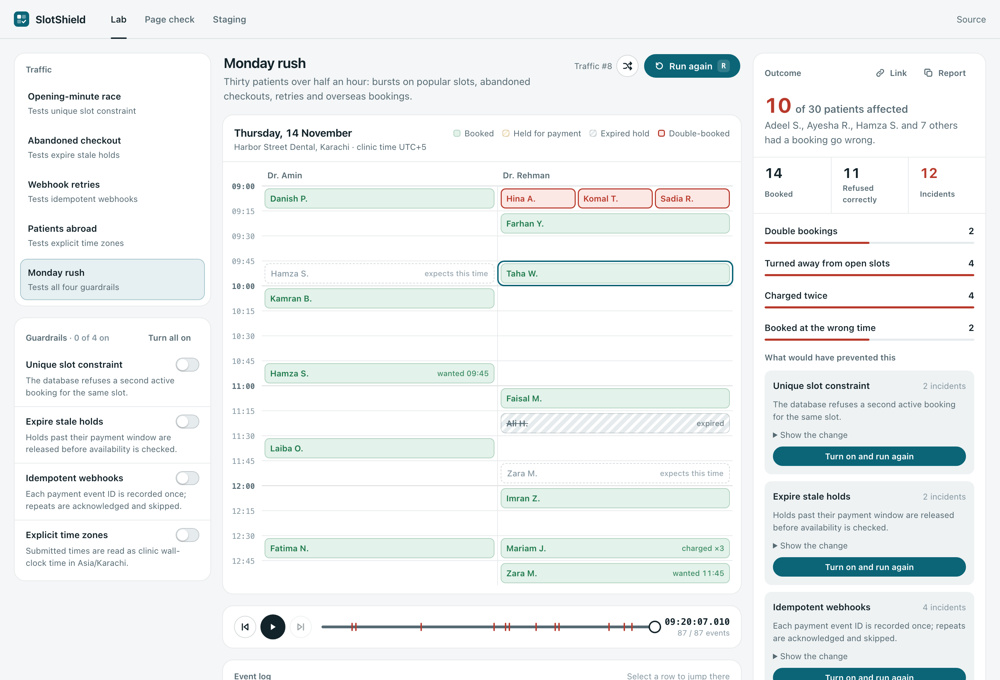

# SlotShield

SlotShield sends realistic traffic through a model of a clinic's booking API and shows you, appointment by appointment, what goes wrong when a guardrail is missing.

Turn the unique slot constraint off and two patients land in the same chair. Leave stale holds alone and an abandoned checkout keeps a free slot blocked for good. Process webhook retries twice and someone pays their deposit twice. Read a browser's timestamp at face value and a patient in Dubai turns up an hour early.

<picture>
  <source media="(prefers-color-scheme: dark)" srcset="docs/lab-dark.png" />
  
</picture>

[Open the live demo](https://m-nabeegh.gitlab.io/slotshield/) · [Staging adapter contract](docs/test-adapter-contract.md)

## How it works

The lab is a small discrete-event simulation (`src/engine`). Every booking request reads availability, waits a few milliseconds, then writes, the way a real API handler does. Each guardrail changes one real decision point. Nothing is scripted, so the outcome comes from the model itself:

| Guardrail | Decision it changes | Without it |
| --- | --- | --- |
| Unique slot constraint | The database checks for an active booking at write time | Requests whose reads overlap both succeed |
| Expire stale holds | Lapsed payment holds are released before availability is read | Abandoned checkouts block open slots |
| Idempotent webhooks | Payment event IDs are recorded and repeats skipped | Each provider retry captures the deposit again |
| Explicit time zones | Submitted times are read as clinic time (Asia/Karachi) | The browser's offset shifts or voids the appointment |

There are five kinds of traffic. Four focus on one failure each; **Monday rush** sends thirty patients over half an hour from a seeded generator, so a given traffic number always replays identically.

After a run you can:

- step through every request, write, and webhook on a replay scrubber, with incidents marked
- see who was affected and which guardrail would have prevented each incident, with the SQL or code change
- switch that guardrail on and run again in one click, then compare runs side by side in the history
- copy a link that reopens the exact setup, or a Markdown report for a ticket

## Page check and staging adapter

**Page check** fetches a public booking page once, with a 5 second timeout, a 128 KB cap and at most two redirects. It reports reachability, HTTPS, timing, and same-site links that look like booking pages. It refuses private and local addresses and never submits anything.

**Staging** runs the same four scenarios against your own staging API through two test-only endpoints. The manifest has to declare `testOnly: true`, every run gets its own namespace, and the token is used once and never stored. See the [adapter contract](docs/test-adapter-contract.md).

Both need the small server built into the dev and preview servers. The GitLab Pages build is static, so there the lab works fully and these two pages explain how to run them locally.

## Run it

Requires Node.js 22.13 or newer.

```bash
npm install
npm run dev
```

```bash
npm test             # engine, share links, UI interactions, API handlers
npm run lint
npm run build        # app with API routes (vite preview serves them)
npm run build:pages  # static build for GitLab Pages
```

## Project layout

```text
src/engine/    simulation, scenarios, seeded traffic, guardrail definitions
src/lab/       schedule, replay, event log, outcome, history, share links
src/check/     public page check
src/adapter/   staging adapter runner
server/        URL safety, page inspection, adapter contract, Vite middleware
docs/          adapter contract and screenshots
```

Harbor Street Dental and its patients are fictional. No real bookings, payments, or patient data are involved.

Built by Muhammad Nabeegh.
